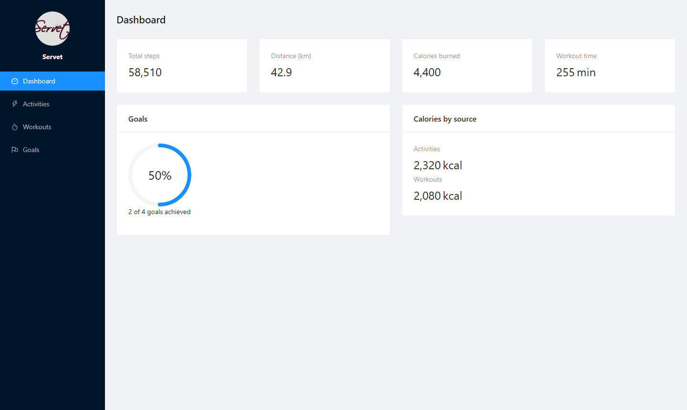
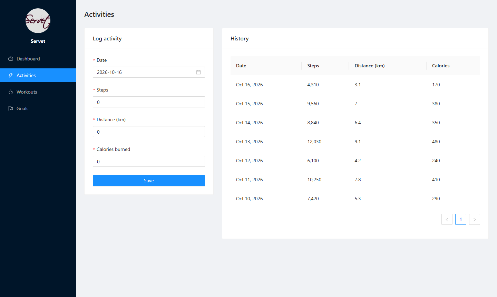
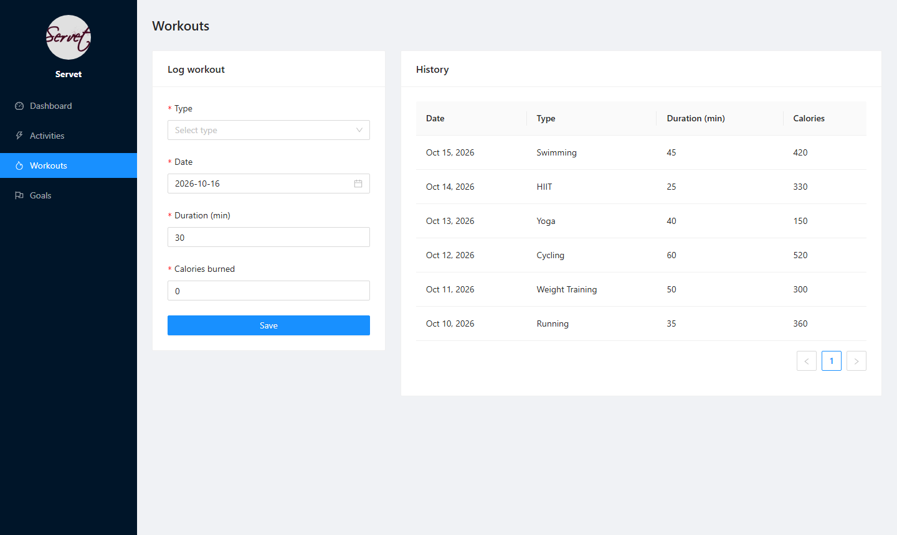
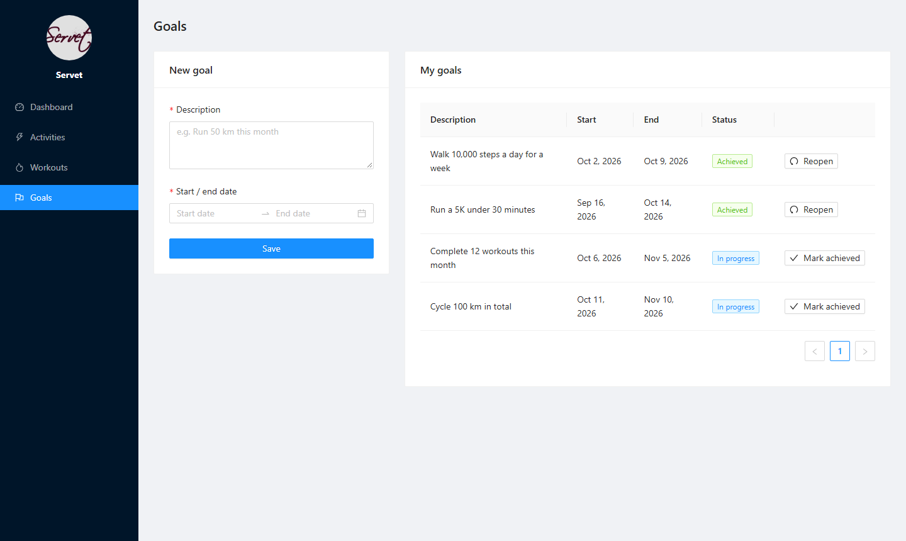
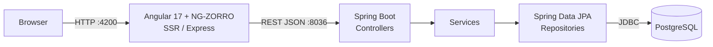
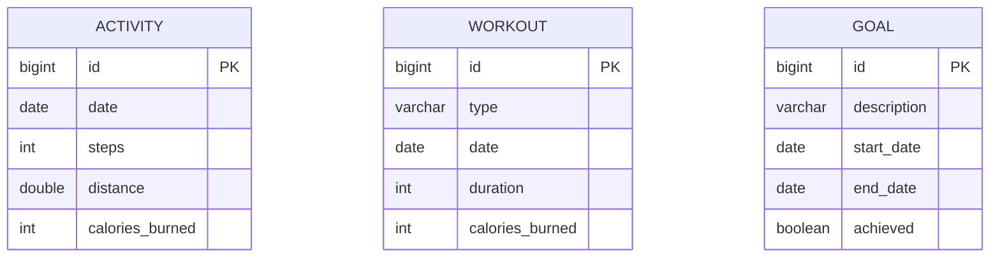

# Fitness Tracker

A full-stack fitness tracking app: log daily activities and workouts, set goals with a date range, and follow your progress on a dashboard.

Built with **Spring Boot 3** (REST API), **Angular 17** (standalone components, SSR) with **NG-ZORRO / Ant Design**, and **PostgreSQL**.


[](https://github.com/Albatros46/FitnessTracker/actions/workflows/ci.yml)


`#java` `#spring-boot` `#spring-data-jpa` `#hibernate` `#rest-api` `#angular` `#typescript` `#ng-zorro` `#ant-design` `#angular-ssr` `#postgresql` `#docker-compose` `#github-actions` `#full-stack` `#fitness-tracker`

---

## Highlights

- **Full-stack monorepo** – Spring Boot REST API and Angular SPA in one repository, started with three commands
- **Clean layered backend** – Controller → Service → Repository, Java `record` DTOs, constructor injection
- **Validation end to end** – Angular reactive forms + Jakarta Bean Validation (incl. a cross-field date-range rule), errors returned as RFC 7807 `ProblemDetail`
- **Aggregations in the database** – dashboard totals computed with JPQL `SUM` / `COUNT` queries, not in memory
- **Modern Angular 17** – standalone components, new `@if` / `@for` control flow, lazy-loaded routes, SSR
- **Tested & automated** – MockMvc integration tests on in-memory H2, GitHub Actions CI on every push, PostgreSQL via Docker Compose with schema and demo data

---

## Screenshots

| Dashboard | Activities |
|---|---|
|  |  |

| Workouts | Goals |
|---|---|
|  |  |

## Features

- **Dashboard** – total steps, distance, calories burned and workout time, plus goal progress
- **Activities** – log steps, distance and calories per day and browse the history
- **Workouts** – log workout type, duration and calories
- **Goals** – create goals with a start and end date, mark them as achieved or reopen them
- **Validation on both sides** – reactive forms in Angular and Bean Validation in Spring; errors are returned as RFC 7807 `ProblemDetail`
- **Server-side rendering** with Angular SSR and lazy-loaded routes

## Tech Stack

| Layer | Technologies |
|---|---|
| **Frontend** | Angular 17 (standalone components, `@for` / `@if` control flow), TypeScript 5, RxJS, Reactive Forms, NG-ZORRO (Ant Design), Angular SSR (Express) |
| **Backend** | Java 17, Spring Boot 3.3, Spring Web, Spring Data JPA (Hibernate 6), Jakarta Bean Validation |
| **Database** | PostgreSQL 16 (H2 in-memory for tests) |
| **Testing** | JUnit 5, Spring Boot Test, MockMvc, Jasmine, Karma |
| **DevOps** | Docker Compose, GitHub Actions (CI), Maven Wrapper, npm |

## Architecture



The backend follows a layered design: **Controller → Service → Repository → Entity**. DTOs are Java `record`s, and a global `@RestControllerAdvice` turns validation and not-found errors into consistent JSON responses.

## Database

PostgreSQL with three tables. The schema is in [`database/01-schema.sql`](database/01-schema.sql), demo data in [`database/02-seed.sql`](database/02-seed.sql).



| Table | Purpose | Constraints |
|---|---|---|
| `activity` | Daily steps, distance (km) and calories | values ≥ 0, indexed by `date` |
| `workout` | Workout type, duration (min) and calories | `duration > 0`, indexed by `date` |
| `goal` | Goal with a date range and status | `end_date >= start_date`, indexed by `end_date` |

## REST API

Base URL: `http://localhost:8036/api`

| Method | Endpoint | Description |
|---|---|---|
| `POST` | `/activity` | Create an activity |
| `GET` | `/activities` | List activities (newest first) |
| `POST` | `/workout` | Create a workout |
| `GET` | `/workouts` | List workouts (newest first) |
| `POST` | `/goal` | Create a goal |
| `GET` | `/goals` | List goals (by end date) |
| `PUT` | `/goal/{id}/status?achieved=true` | Mark a goal as achieved or reopen it |
| `GET` | `/stats` | Aggregated statistics for the dashboard |

Example:

```bash
curl -X POST http://localhost:8036/api/activity \
  -H "Content-Type: application/json" \
  -d '{"date":"2026-10-16","steps":8500,"distance":6.2,"caloriesBurned":340}'
```

## Getting Started

### Prerequisites

- Java 17+
- Node.js 18+ and npm
- PostgreSQL 16+ **or** Docker

### 1. Database

**Option A – Docker:** creates the database, schema and demo data.

```bash
docker compose up -d
```

> If port 5432 is already in use: `POSTGRES_PORT=5433 docker compose up -d` and set `DB_URL` accordingly.

**Option B – local PostgreSQL:** create a database named `Fitness_Tracker`. Tables are created automatically on first start; the scripts in `database/` are optional.

### 2. Backend

```bash
cd FitnessTrackerServer
./mvnw spring-boot:run        # Windows: mvnw.cmd spring-boot:run
```

The API runs on `http://localhost:8036`. Connection settings can be overridden with environment variables:

| Variable | Default |
|---|---|
| `DB_URL` | `jdbc:postgresql://localhost:5432/Fitness_Tracker` |
| `DB_USERNAME` | `postgres` |
| `DB_PASSWORD` | `root` |

### 3. Frontend

```bash
cd FitnessTrackerWeb
npm install
npm start
```

Open `http://localhost:4200`.

## Tests

```bash
# Backend – integration tests with MockMvc and in-memory H2 (no PostgreSQL needed)
cd FitnessTrackerServer && ./mvnw test

# Frontend – unit tests
cd FitnessTrackerWeb && npx ng test --watch=false --browsers=ChromeHeadless
```

GitHub Actions runs both on every push and pull request ([`.github/workflows/ci.yml`](.github/workflows/ci.yml)).

## Project Structure

```
FitnessTracker/
├── FitnessTrackerServer/          # Spring Boot REST API
│   └── src/main/java/com/server/
│       ├── controller/            # REST endpoints
│       ├── service/               # Business logic
│       ├── repository/            # Spring Data JPA
│       ├── entity/                # JPA entities
│       ├── dto/                   # Request/response records
│       ├── exception/             # Global error handling
│       └── config/                # CORS configuration
├── FitnessTrackerWeb/             # Angular 17 frontend
│   └── src/app/
│       ├── pages/                 # dashboard, activity, workout, goal
│       ├── services/              # API client
│       └── models/                # TypeScript interfaces
├── database/                      # Schema and demo data
├── docs/screenshots/
└── docker-compose.yml
```

## Roadmap

- [ ] User registration and authentication (Spring Security + JWT)
- [ ] Charts for weekly and monthly trends
- [ ] Edit and delete entries
- [ ] Docker images for backend and frontend

## Author

**Servet Akcadag** – contributions, issues and feedback are welcome. If you find the project useful, please give it a ⭐.

## License

Licensed under the [MIT License](LICENSE).
